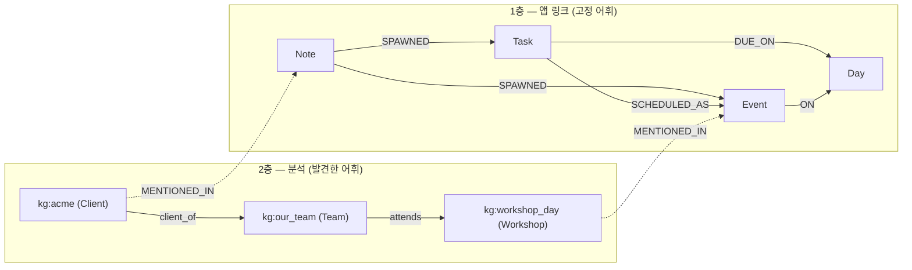
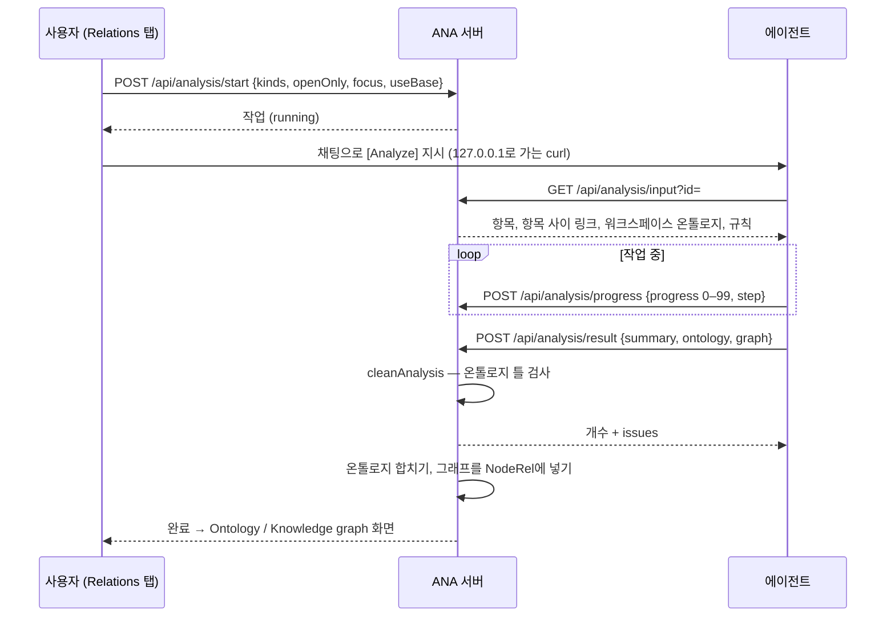

# ANA의 관계 — 두 층, 온톨로지와 지식그래프

[English](relations.md) · **한국어**

ANA는 관계 정보를 **두 층**으로 다룹니다. 각 층에는 *틀*(어떤 종류의 것과 관계가 있을 수 있는지)과 *데이터*(실제 것과 연결)가 있습니다.

| | 틀 ("온톨로지") | 데이터 ("그래프") |
|---|---|---|
| **1층 — 앱 링크** (고정) | 종류 4개(Note · Task · Event · Day)와 관계 5개. **코드에 고정**(`graph.js`) | 실제 메모·할일·일정 사이의 링크 |
| **2층 — 분석** (발견) | 에이전트가 **내용에서 찾아낸** 클래스와 관계 종류(Relations › Analyze) | 항목에서 뽑은 개체와 사실. 각각 근거 항목을 가리킴 |

두 층은 워크스페이스마다 하나인 NodeRel 인덱스(`graph.sqlite`)에 함께 들어갑니다. 그래서 질의 한 번으로 메모에서 그 안에 나오는 사람·조직까지 따라갈 수 있습니다.



---

## 1층 — 앱 링크 (고정)

무엇이 무엇과 이어질 수 있는지는 앱이 정합니다. 어휘는 `graph.js`(`RULES`, `MEANINGS`)에 있고 실행 중에 바뀌지 않습니다.

| 관계 | From → To | 의미 | 종류 |
|---|---|---|---|
| `SPAWNED` | Note → Task · Event | 할일·일정이 나온 메모 | 명시 |
| `SCHEDULED_AS` | Task → Event | 할일을 하려고 잡은 시간 | 명시 |
| `REFERS_TO` | 아무거나 → 아무거나 | 수동 참조 | 명시 |
| `DUE_ON` | Task → Day | `task.due`에서 | 파생 |
| `ON` | Event → Day | `event.date`에서 | 파생 |

- **진실원천:** `state.json`(`items`, `events`, `notes`, 명시적 `links[]`). `graph.sqlite`는 파생 인덱스입니다. 스냅숏 서명이 바뀌면 다시 만들어지므로, 화면에서 만들든 에이전트 diff로 만들든 파일을 직접 고치든 모두 반영됩니다.
- **검증:** `POST /api/link`는 `checkLink`로 방향을 확인합니다. 예를 들어 `SPAWNED`로 Task → Note를 만들 수 없습니다.
- **쓰이는 곳:** 항목의 관계 칩, Links 흐름 그림, "흐름이 끊긴 곳", 에이전트용 `/api/graph/*`.

---

## 2층 — 분석 (발견)

**System › Relations › Analyze**는 에이전트에게 항목을 읽고 앱에 아직 없는 구조를 적게 합니다. 누가 고객인지, 워크숍에 무엇이 필요한지, 통화가 어떤 버그에 달려 있는지 같은 것입니다.

### 분석 과정



1. **대상 고르기.** 창에서 메모·할일·일정을 고릅니다(개수 표시). 열린 것만 고를 수도 있고, "사람, 조직, 장소" 같은 초점을 줄 수도 있습니다. 워크스페이스에 이미 온톨로지가 있으면 *Build on this workspace's ontology*가 기본으로 켜집니다. 분석은 한 번에 하나만 돕니다.
2. **에이전트에게 넘기기.** 화면이 정확한 `curl`이 담긴 `[Analyze]` 지시를 보냅니다. 주소는 브라우저 주소가 아니라 **서버의 로컬 주소**(`/api/agent-base` → `127.0.0.1:<포트>`)입니다. 그래서 로그인 게이트웨이에 막히지 않습니다.
3. **에이전트가 읽기.** `GET /api/analysis/input?id=`는 다음을 돌려줍니다.
   - 항목(메모 전문, 할일 기한·완료, 일정 날짜·시간)
   - 항목 사이의 기존 링크
   - 워크스페이스 온톨로지(이어 쓸 때)
   - 결과가 지켜야 할 규칙
4. **진행률.** 에이전트가 `progress`(0–99)와 짧은 `step`을 보고합니다. 카드에는 진행 막대, 단계, 경과 시간이 보이고, 3분 동안 소식이 없으면 경고가 뜹니다. 채팅을 열거나 취소할 수 있습니다.
5. **결과.** 에이전트가 `summary`, `ontology`, `graph`를 보냅니다. 서버는 아래 검사를 하고 저장한 뒤, 개수와 `issues`를 답합니다. 버려진 사실이 많으면 에이전트가 고쳐서 새 분석을 돌려야 합니다.
6. **끝내지 못하면** `POST /api/analysis/fail {id, reason}`. 화면에 *Failed*와 이유가 보입니다.

작업은 워크스페이스마다 `state.json` 옆의 `analysis.json`에 최근 10개까지 저장됩니다.

### 온톨로지 — 틀

온톨로지는 **어떤 종류의 것이 있고, 서로 어떻게 이어질 수 있는지**를 정합니다.

```json
"ontology": {
  "classes": [
    { "id": "Agent",        "label": "Agent",        "parent": "" },
    { "id": "Organization", "label": "Organization", "parent": "Agent" },
    { "id": "Client",       "label": "Client",       "parent": "Organization",
      "desc": "An external organization we serve" }
  ],
  "relations": [
    { "id": "client_of", "label": "client of", "domain": "Client", "range": "Organization",
      "desc": "The client buys from or works with the organization" }
  ]
}
```

- **클래스**는 `parent`로 트리를 이룹니다(Client ⊂ Organization ⊂ Agent).
- **관계 종류**에는 `domain`(From)과 `range`(To)가 있습니다. 비어 있으면 어떤 클래스든 됩니다.
- **이어 씁니다.** 워크스페이스마다 지금까지 만든 온톨로지를 쌓아 둡니다(`analysis.json` → `ontology`).
  - `mergeOntology`가 결과를 id 기준으로 합칩니다. 설명은 나중 것이 이깁니다.
  - 다음 분석은 이 온톨로지를 입력으로 받습니다. 그래서 다음에 `Customer`를 새로 만들지 않고 `Client`를 다시 씁니다.
  - 앞 회차에서 가져온 클래스와 관계는 *(earlier)*로 표시됩니다.
  - *Start fresh*(`POST /api/analysis/ontology/reset`)로 비웁니다. 지난 결과는 그대로 남습니다.
- **보이는 모습:** 클래스마다 색이 붙은 클래스 트리, 그리고 관계 종류 표(From → To, 사용 횟수).

### 지식그래프 — 데이터

지식그래프는 **실제로 무엇이 있고 그것에 대해 무엇이 참인지**를 적습니다. 각각 그것이 나온 항목과 이어져 있습니다.

```json
"graph": {
  "entities": [
    { "id": "acme",     "label": "Acme",                 "class": "Client", "sources": ["n-ex-acme", "e-ex-acme"] },
    { "id": "our_team", "label": "Our team (20 people)", "class": "Team",   "sources": ["n-ex-workshop"] }
  ],
  "facts": [
    { "from": "acme", "rel": "client_of", "to": "our_team", "sources": ["n-ex-acme"] }
  ]
}
```

- `entity.class`는 온톨로지의 클래스를, `fact.rel`은 온톨로지의 관계 종류를 가리킵니다. 분석의 두 부분은 이 연결 하나로만 이어집니다.
- `sources`는 이 작업의 항목 id입니다. 개체를 누르면 그 사실들이 보이고, 근거 칩을 누르면 해당 메모·할일·일정으로 이동합니다.
- **보이는 모습:** 힘 기반 배치(Fruchterman–Reingold로 배치하고 화면에 맞춘 뒤, 라벨이 겹치지 않게 간격을 다시 벌림). 사실이 30개를 넘으면 개체를 고르기 전까지 선 라벨을 숨깁니다.

### 결과를 온톨로지 틀로 검사하기

`cleanAnalysis`가 틀을 지키게 합니다. 아는 클래스와 관계는 결과에 들어 있는 것 **더하기** 워크스페이스 온톨로지입니다.

| 검사 | 어기면 |
|---|---|
| 크기(클래스 80, 관계 80, 개체 400, 사실 1200) | 나머지는 잘림 |
| `class.parent`가 있는가 | 부모 비움, issue |
| `relation.domain` / `range`가 있는가 | 비움(= 아무 클래스), issue |
| `entity.class`가 있는가 | 클래스만 비우고 개체는 남김, issue |
| `entity.sources` / `fact.sources`가 이 작업의 항목인가 | 해당 id 제거 |
| `fact.from` / `fact.to`가 개체인가 | 사실 버림, issue |
| `fact.rel`이 있는가 | 사실 버림, issue |
| `from`의 클래스가 domain **또는 그 하위 클래스**인가, `to`와 range도 같은 방식 | 사실 버림, issue |

issue는 에이전트에게 돌아가고, 작업에 저장되며, 화면에 *⚠ N items didn't fit the ontology*로 보입니다. 결과가 사용한 기존 클래스와 관계는 `inherited` 표시를 달아 작업에 복사합니다. 그래서 작업 하나만 봐도 틀이 온전합니다.

### NodeRel 안의 지식그래프

최신 완료 분석은 1층과 같은 `graph.sqlite`에 들어갑니다(`createGraph({ loadKg })`).

| NodeRel에서 | 어디서 왔나 |
|---|---|
| 노드 `kg:<개체 id>`, kind = 클래스 id | 개체마다. 클래스 이름이 Note/Task/Event/Day이면 `NoteEntity` 등으로 바꿔 1층과 섞이지 않게 함 |
| 관계 id를 타입으로 하는 엣지 | 사실마다. 1층 이름과 같은 관계는 앞에 `kg_`를 붙임 |
| 엣지 `MENTIONED_IN` 개체 → 항목 | 개체의 근거마다 |

이렇게 하면 에이전트가 다음을 할 수 있습니다.

```bash
# 메모에서 출발해 그 안의 사람·조직과 그에 대한 사실까지
curl -s "http://127.0.0.1:8811/api/graph/trace?id=n-ex-acme&depth=2"
# 개체 하나 주변 전부
curl -s "http://127.0.0.1:8811/api/graph/neighbors?id=kg:acme"
# 두 층의 어휘(지식그래프 관계의 From → To, 클래스와 부모)
curl -s "http://127.0.0.1:8811/api/graph/schema"
```

Links 흐름 그림과 "흐름이 끊긴 곳"은 1층만 쓰므로 전과 같습니다. 지식그래프는 Analyze를 다시 돌려야만 바뀝니다. `/api/link`로는 바꿀 수 없습니다.

### 내보내기와 OntoAir

- **Download .ttl**(`GET /api/analysis/ttl?id=`)은 OWL Turtle을 씁니다.
  - 온톨로지는 TBox입니다: `rdfs:subClassOf`가 붙은 `owl:Class`, `rdfs:domain` / `rdfs:range`가 붙은 `owl:ObjectProperty`.
  - 지식그래프는 ABox입니다: 클래스로 타입이 정해지고 `rdfs:label`이 붙은 개체, 그리고 사실마다 트리플 하나.
  - 로컬 이름에는 유니코드 글자를 그대로 둡니다. 라벨의 `#`은 `＃`로 바꿉니다. 줄 단위 Turtle 파서(OntoAir 포함)는 `#`에서 줄을 잘라 버리기 때문입니다.
- **Open in OntoAir ↗**는 [OntoAir](https://poc.aifactory.space/ontoair/)를 열면서 그래프를 **링크 안에 담아** 넘깁니다.
  - OntoAir는 `#` 뒤의 주소를 fetch하므로, ANA는 Turtle을 담은 `data:` URL을 넘깁니다.
  - 브라우저는 `#` 뒤를 서버로 보내지 않습니다. 그래서 로그인 게이트웨이 뒤에서도 열리고 OntoAir를 고칠 필요도 없습니다.
  - 링크가 1.5MB를 넘을 때만 24시간 토큰 링크로 넘어갑니다(`/api/analysis/shared/<토큰>/<이름>.ttl`, CORS `*`). `HEAD /api/analysis/share-access?t=`가 204를 답하므로, 게이트웨이가 유효한 토큰만 통과시키게 할 수 있습니다.
  - 그것도 막히면 파일을 내려받아 OntoAir의 📄 File로 엽니다.

링크 안에 데이터가 그대로 들어 있습니다. 그 데이터를 봐도 되는 사람에게만 공유하세요.

---

## API 요약

| 엔드포인트 | 용도 |
|---|---|
| `POST /api/analysis/start {kinds, openOnly?, focus?, useBase?}` | 작업 시작(한 번에 하나) |
| `GET /api/analysis/input?id=` | 항목, 항목 사이 링크, 워크스페이스 온톨로지, 규칙(에이전트용) |
| `POST /api/analysis/progress {id, progress, step}` | 0–99. 100은 결과가 정함 |
| `POST /api/analysis/result {id, summary, ontology, graph}` | 검사 → `{개수…, issues}` |
| `POST /api/analysis/fail {id, reason}` · `/cancel {id}` | 진행 중인 작업 끝내기 |
| `GET /api/analysis` | `{jobs, latest, ontology}` |
| `POST /api/analysis/ontology/reset` | 워크스페이스 온톨로지를 처음부터 |
| `GET /api/analysis/ttl?id=` | OWL Turtle 내려받기 |
| `POST /api/analysis/share {id}` · `GET /api/analysis/shared/<토큰>/<이름>.ttl` | 24시간 공개 링크(아주 큰 그래프용 대안) |
| `GET /api/agent-base` | 에이전트 지시문에 넣을 서버 로컬 주소 |
| `GET /api/graph/neighbors · trace · schema` | NodeRel로 두 층 모두 |

코드:
- `dashboard-api.js`: `cleanAnalysis`, `mergeOntology`, `analysisTurtle`, `/api/analysis*`
- `graph.js`: `kg`를 받는 `snapshot`, `KG_PREFIX`, `kgKind`, `kgType`
- `dashboard.html`: `openAnaModal`, `renderAnalysis`, `drawKG`, `openInOntoAir`

테스트는 `test.cjs`의 C14(1층), C16·C18(분석, 온톨로지 검사, 이어 쓰기, NodeRel, 내보내기)입니다. 이식 안내는 [`skills/relations`](../skills/relations/SKILL.md)에 있습니다.
