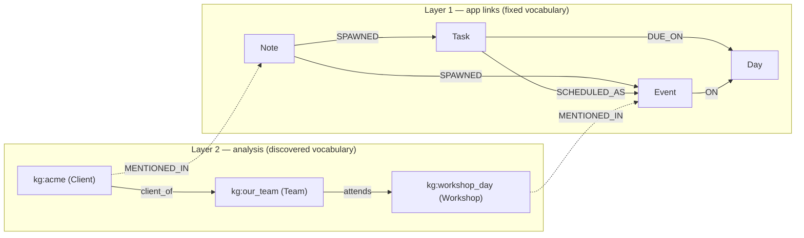
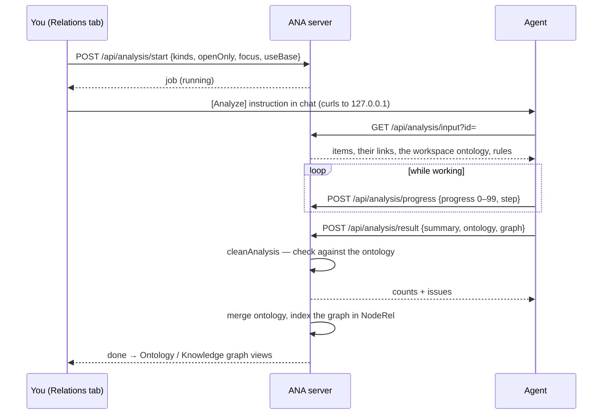

# Relations in ANA — two layers, ontology and knowledge graph

**English** · [한국어](relations.ko.md)

ANA keeps relation information in **two layers**. Each layer has a *schema* (what kinds of things and relations may exist) and *data* (the actual things and links).

| | Schema ("ontology") | Data ("graph") |
|---|---|---|
| **Layer 1 — app links** (fixed) | 4 kinds (Note · Task · Event · Day) and 5 relation types, **fixed in code** (`graph.js`) | the links between your actual notes, tasks and events |
| **Layer 2 — analysis** (discovered) | classes and relation types the agent **finds in your content** (Relations › Analyze) | entities and facts extracted from the items, each citing its source items |

Both layers end up in the same per-workspace NodeRel index (`graph.sqlite`), so one query can walk from a note to the people and organizations mentioned in it.



---

## Layer 1 — app links (fixed)

The app defines what can link to what. The vocabulary lives in `graph.js` (`RULES`, `MEANINGS`) and doesn't change at run time.

| Relation | From → To | Meaning | Kind |
|---|---|---|---|
| `SPAWNED` | Note → Task · Event | where a task or event came from | explicit |
| `SCHEDULED_AS` | Task → Event | time blocked to do the task | explicit |
| `REFERS_TO` | any → any | manual reference | explicit |
| `DUE_ON` | Task → Day | from `task.due` | derived |
| `ON` | Event → Day | from `event.date` | derived |

- **Source of truth:** `state.json` (`items`, `events`, `notes`, and explicit `links[]`). `graph.sqlite` is a derived index, rebuilt whenever the snapshot signature changes, so a link made in the UI, by an agent diff or by hand all show up.
- **Validation:** `POST /api/link` runs `checkLink`, which rejects wrong directions such as Task → Note for `SPAWNED`.
- **Used by:** relation chips on items, the Links flow chart, "Where the flow breaks", and `/api/graph/*` for the agent.

---

## Layer 2 — analysis (discovered)

**System › Relations › Analyze** asks the agent to read your items and write down structure the app doesn't have yet: who the client is, what the workshop needs, which bug the call depends on.

### The analysis process



1. **Pick targets.** In the modal, choose notes, tasks and events (with counts), optionally only open ones, and an optional focus such as "people, organizations, places". If the workspace already has an ontology, *Build on this workspace's ontology* is on by default. One analysis runs at a time.
2. **Hand it to the agent.** The page sends an `[Analyze]` instruction with exact `curl`s. They point at the server's **local address** (`/api/agent-base` → `127.0.0.1:<port>`), not the browser's, so the agent isn't blocked by a sign-in gateway.
3. **Agent reads.** `GET /api/analysis/input?id=` returns the items (full note text, task due/done, event date/time), the existing links between them, the workspace ontology (when building on it), and the rules the result must follow.
4. **Progress.** The agent reports `progress` (0–99) and a short `step`. The card shows a bar, the step, elapsed time, and a warning after 3 minutes without an update. You can open the chat or cancel.
5. **Result.** The agent posts `summary`, `ontology` and `graph`. The server checks it (below), saves it, and replies with counts and `issues`. If many facts were dropped, the agent should fix them and run a new analysis.
6. **If it can't finish:** `POST /api/analysis/fail {id, reason}`, shown as *Failed* with the reason.

Jobs are stored per workspace in `analysis.json` next to `state.json` (the last 10).

### The ontology — the schema layer

The ontology says **what kinds of things exist and how they may relate**.

```json
"ontology": {
  "classes": [
    { "id": "Agent",        "label": "Agent",        "parent": "" },
    { "id": "Organization", "label": "Organization", "parent": "Agent" },
    { "id": "Client",       "label": "Client",       "parent": "Organization",
      "desc": "An external organization we serve" }
  ],
  "relations": [
    { "id": "client_of", "label": "client of", "domain": "Client", "range": "Organization",
      "desc": "The client buys from or works with the organization" }
  ]
}
```

- **Classes** form a tree through `parent` (Client ⊂ Organization ⊂ Agent).
- **Relation types** have a `domain` (From) and a `range` (To). An empty domain or range means any class.
- **It carries over.** Each workspace keeps the ontology built so far (`analysis.json` → `ontology`). `mergeOntology` folds each result in by id, and the latest description wins. The next analysis gets it in its input, so the agent reuses `Client` instead of inventing `Customer` the next time. Classes and relations reused from earlier runs are shown as *(earlier)*. *Start fresh* (`POST /api/analysis/ontology/reset`) clears it; past results stay.
- **Shown as:** the class tree with one color per class, and a relation-type table (From → To, number of uses).

### The knowledge graph — the data layer

The knowledge graph says **which actual things exist and what is true about them**, each tied to the items it came from.

```json
"graph": {
  "entities": [
    { "id": "acme",     "label": "Acme",                 "class": "Client", "sources": ["n-ex-acme", "e-ex-acme"] },
    { "id": "our_team", "label": "Our team (20 people)", "class": "Team",   "sources": ["n-ex-workshop"] }
  ],
  "facts": [
    { "from": "acme", "rel": "client_of", "to": "our_team", "sources": ["n-ex-acme"] }
  ]
}
```

- `entity.class` points to an ontology class, and `fact.rel` to an ontology relation type. That pointer is the only link between the two layers of analysis.
- `sources` are item ids from the job. Tapping an entity shows its facts, and its source chips jump to the note, task or event.
- **Shown as:** a force layout (Fruchterman–Reingold, fitted to the frame, then a spacing pass so labels don't collide). Edge labels hide above 30 facts until you select an entity.

### Checking the result against the ontology

`cleanAnalysis` enforces the schema. The known classes and relations are the ones in the result **plus** the workspace ontology.

| Check | If it fails |
|---|---|
| sizes (80 classes, 80 relations, 400 entities, 1200 facts) | the rest is cut |
| `class.parent` exists | parent cleared, issue |
| `relation.domain` / `range` exist | cleared (= any class), issue |
| `entity.class` exists | class cleared, entity kept, issue |
| `entity.sources` / `fact.sources` are items of this job | those ids removed |
| `fact.from` / `fact.to` are entities | fact dropped, issue |
| `fact.rel` exists | fact dropped, issue |
| `from`'s class is the domain **or a sub-class of it**, likewise `to` and range | fact dropped, issue |

Issues are returned to the agent, stored on the job, and shown as *⚠ N items didn't fit the ontology*. Existing classes and relations that the result used are copied into the job, marked `inherited`, so each job is a complete picture on its own.

### The knowledge graph inside NodeRel

The latest finished analysis is indexed in the same `graph.sqlite` as Layer 1 (`createGraph({ loadKg })`):

| In NodeRel | From |
|---|---|
| node `kg:<entity id>`, kind = the class id | each entity (a class named Note/Task/Event/Day becomes `NoteEntity`, … so it never mixes with Layer 1) |
| edge typed by the relation id | each fact (a relation named like a Layer 1 type gets a `kg_` prefix) |
| edge `MENTIONED_IN` entity → item | each entity source |

What that gives the agent:

```bash
# from a note to the people and organizations in it, and what is true about them
curl -s "http://127.0.0.1:8811/api/graph/trace?id=n-ex-acme&depth=2"
# everything around one entity
curl -s "http://127.0.0.1:8811/api/graph/neighbors?id=kg:acme"
# the vocabulary of both layers (knowledge-graph relations with From → To, classes with parents)
curl -s "http://127.0.0.1:8811/api/graph/schema"
```

The Links flow chart and the gap lists only use Layer 1, so they look the same as before. The knowledge graph changes only by running Analyze again, never through `/api/link`.

### Export and OntoAir

- **Download .ttl** (`GET /api/analysis/ttl?id=`) writes OWL Turtle. The ontology is the TBox: `owl:Class` with `rdfs:subClassOf`, and `owl:ObjectProperty` with `rdfs:domain` / `rdfs:range`. The knowledge graph is the ABox: individuals typed by class with `rdfs:label`, plus one triple per fact. Local names keep Unicode letters. A `#` in a label becomes `＃`, because line-based Turtle parsers (OntoAir's included) cut a line at `#`.
- **Open in OntoAir ↗** opens [OntoAir](https://poc.aifactory.space/ontoair/) with the graph **inside the link**. OntoAir fetches whatever URL follows `#`, so ANA passes a `data:` URL that holds the Turtle. Browsers never send the part after `#` to a server. This works even behind a sign-in gateway and needs no change to OntoAir. Only when the link would exceed 1.5 MB does ANA fall back to a 24-hour token link (`/api/analysis/shared/<token>/<name>.ttl`, CORS `*`; `HEAD /api/analysis/share-access?t=` answers 204 so a gateway can allow valid tokens only). If that is blocked too, it downloads the file for OntoAir's 📄 File.

The link contains the data itself, so share it only with people who may see that data.

---

## API summary

| Endpoint | Purpose |
|---|---|
| `POST /api/analysis/start {kinds, openOnly?, focus?, useBase?}` | start a job (one at a time) |
| `GET /api/analysis/input?id=` | items, their links, workspace ontology, rules (for the agent) |
| `POST /api/analysis/progress {id, progress, step}` | 0–99; 100 is set by the result |
| `POST /api/analysis/result {id, summary, ontology, graph}` | checked → `{counts…, issues}` |
| `POST /api/analysis/fail {id, reason}` · `/cancel {id}` | end a running job |
| `GET /api/analysis` | `{jobs, latest, ontology}` |
| `POST /api/analysis/ontology/reset` | start the workspace ontology over |
| `GET /api/analysis/ttl?id=` | OWL Turtle download |
| `POST /api/analysis/share {id}` · `GET /api/analysis/shared/<token>/<name>.ttl` | 24-hour public link (fallback for very large graphs) |
| `GET /api/agent-base` | the server's local address for agent instructions |
| `GET /api/graph/neighbors · trace · schema` | both layers through NodeRel |

Code: `dashboard-api.js` (`cleanAnalysis`, `mergeOntology`, `analysisTurtle`, `/api/analysis*`), `graph.js` (`snapshot` with `kg`, `KG_PREFIX`, `kgKind`, `kgType`), `dashboard.html` (`openAnaModal`, `renderAnalysis`, `drawKG`, `openInOntoAir`). Tests: `test.cjs` C14 (Layer 1), C16 and C18 (analysis, ontology checks, carry-over, NodeRel, export). Porting guide: [`skills/relations`](../skills/relations/SKILL.md).
